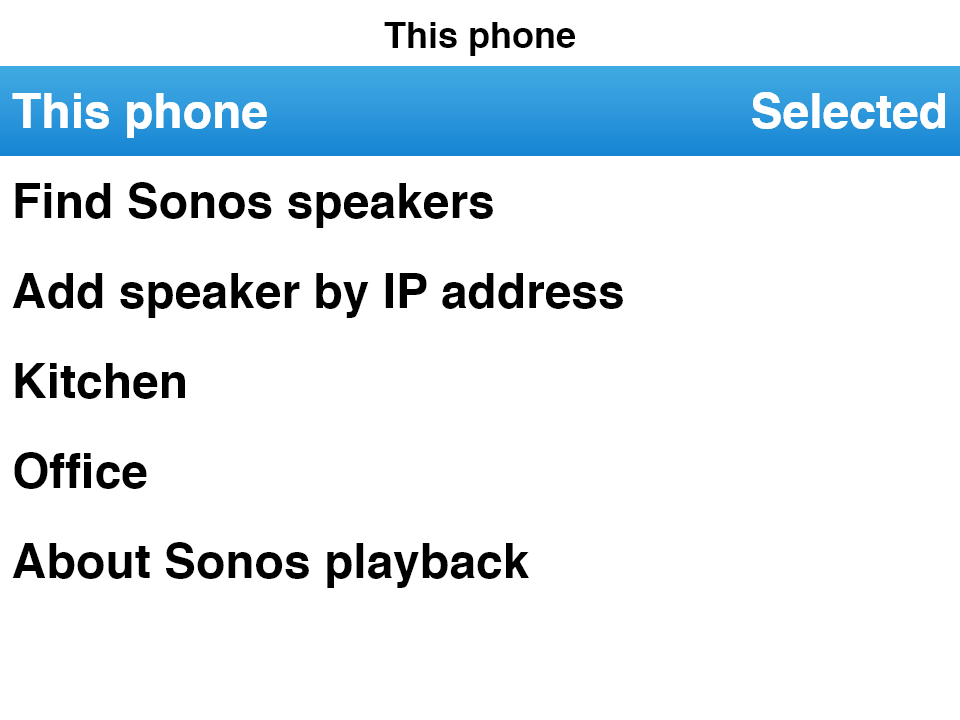
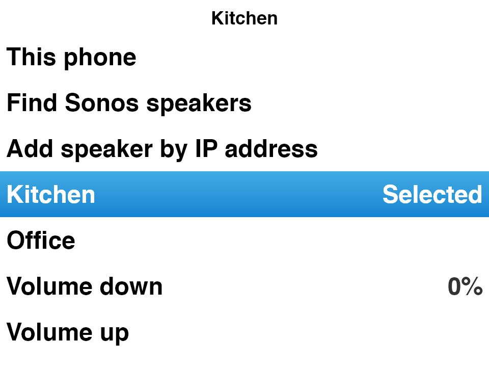

# Sonos playback

## Connect and play

On Android, open **Settings → Sonos / Audio output**, or hold Select on Now
Playing and choose **Sonos / Audio output**. Allow local network access when
Android 17 requests it. Keep the phone and Sonos S2 system on the same network.
Choose **Find Sonos speakers**, then choose a room. If discovery is blocked by
your network, use **Add speaker by IP address** with an IPv4 address from the
Sonos app. A manual address still requires the phone to reach port 1400.

Selecting a room pauses phone playback. It does not replace the room's existing
queue until you play a track. Browse Classipod normally to play a server song,
album or playlist. Starting playback replaces the selected group's Sonos queue.
Classipod uploads the queue in batches of 16; a large queue can take time to
prepare. The normal wheel controls and media notification control Sonos. The
Now Playing screen labels the selected room. Choosing **This phone** pauses
Classipod's Sonos playback where reachable and returns to phone output without
autoplaying. If the speaker is unreachable it may continue playing; phone
output remains available. Closing Classipod leaves the speaker-owned queue
playing. Reopening the app defaults to phone output; select Sonos again to
control a room explicitly.

## Music requirements

Sonos fetches tracks directly from Navidrome/Subsonic using authenticated
HTTP(S) URLs, requesting MP3 at up to 320 kbps. Enable MP3 transcoding on the
server. The server URL must resolve and be reachable from the speaker itself:
a phone-only VPN, localhost address or self-signed HTTPS endpoint will not
work merely because the phone can stream it. Song credentials/URLs are not
logged or persisted in Classipod's Sonos settings; the speaker receives the
URLs needed for playback. The queue remains in the speaker until replaced.

Phone-local files and private offline downloads cannot be played on Sonos.
Mixed queues skip phone-local tracks; explicitly selecting one reports that
server music is required. Selecting Sonos never silently falls back to phone
playback. Classipod observes the speaker's track/position/playing state, and
recognizes when another app replaces its queue rather than displaying the
wrong Classipod song. Selecting a Classipod song starts a new queue.

## Volume and groups

Volume affects the selected room, including its bonded speakers, rather than
the phone volume or every room in a group. Use the wheel/volume view or the
Sonos menu's volume actions. Transport commands go to the group's coordinator.

The output menu offers **Group: room** for rooms outside the selected group
and **Remove: room** for existing members. Each change requires confirmation;
moving a room stops that room's previous playback. **Ungroup this room** makes
the selected room standalone. Stereo pairs, surrounds and Subs stay bonded;
satellites/hidden devices are not offered as independent outputs. Coordinator
changes invalidate the old Classipod queue association; select a track again
after moving the selected room to a new coordinator. Room topology and playback
status are refreshed while connected; this does not scan the music library.

## Implementation and validation

This uses local SSDP discovery and Sonos UPnP SOAP services on port 1400, with
no Sonos cloud account, OAuth registration or hosted callback service. The
local interface is not Sonos's supported cloud Control API and may change
with firmware. The current target is Android and an S2 system with Play:1,
Play:3, Play:5, Playbar and bonded Sub. Web output is not offered. iOS multicast
entitlements and Apple local-network permission UI are not implemented.

Discovery follows the ZonePlayer search and reads each speaker's device
identity and ZoneGroupTopology. Multicast replies must advertise the sender's
own port-1400 URL. HTTP operations have timeouts; SOAP faults and media errors
are sanitized. The playback output interface keeps local audio, offline
storage and Sonos transport separate. Classipod prepares network media before
replacing the speaker queue, serializes commands, preserves shuffle/album
shuffle order, and applies repeat modes on the speaker.

Tests use mock SOAP devices and player outputs for discovery parsing,
XML/metadata escaping, fault handling, topology/bonded speakers, queue batches,
track mapping, ownership changes, pause/resume/seek, repeat/shuffle, selected
room volume, notification controls and output switching. Widget tests cover
room selection, confirmation, permission errors and small-screen wheel
scrolling. A read-only network probe found six devices forming five visible
rooms on the target S2 system; it did not change playback or grouping.
Physical playback/grouping and the Android 17 permission prompt still require
phone testing using the PR's APK artifact.

Protocol references: [SoCo discovery](https://github.com/SoCo/SoCo/blob/master/soco/discovery.py),
[SoCo transport and grouping](https://github.com/SoCo/SoCo/blob/master/soco/core.py),
[Android local network permission](https://developer.android.com/privacy-and-security/local-network-permission).

## Output picker previews

Before choosing a room (phone output):

After choosing a room (Sonos output):

